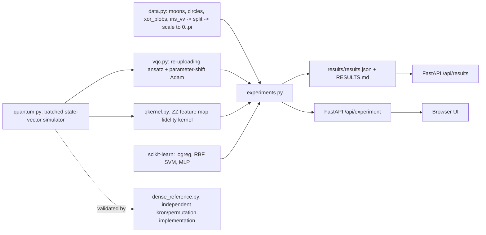

# Architecture

Author: Rayyan Anwar

## Simulator
State vectors have shape `(batch, 2, ..., 2)`; qubit 0 is the leftmost bit. Gates act by axis operations (no 2^n x 2^n matrices); per-sample rotations use `(batch, 2, 2)` gate stacks, which lets one pass evaluate many data points **and** many shifted parameter sets. It is exact and noise-free. `dense_reference.py` rebuilds circuits with Kronecker products and permutation matrices (no shared code) so tests can check agreement to 1e-10.

## VQC
Per layer: optional `RY(x)` data encoding on every qubit (re-uploading), trainable `RY`,`RZ` per qubit, CNOT ring. Output `f = <Z_0> + b`, loss = MSE to +-1 labels, Adam. Each angle feeds one gate, so the two-term parameter-shift rule is exact; a test compares it with finite differences (error about 1e-10).

## Quantum kernel
`K(x,x') = |<psi(x)|psi(x')>|^2` with two repetitions of H, `RZ(2x)`, and CNOT-`RZ`-CNOT entanglers; used with an SVM on the precomputed kernel (C tuned by 3-fold CV).

## Protocol
For each dataset and seed: draw/split (60/40 stratified), scale features to [0, pi] from training statistics, train every model on the same split, report test accuracy and macro-F1. Aggregates are mean +- std over seeds.
